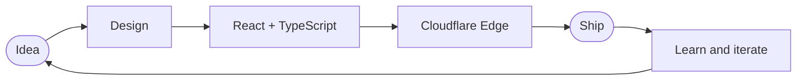
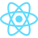
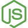

<div align="center">


<a href="https://git.io/typing-svg">
  
</a>

<br/>


</div>

---

##  About

```ts
const emerald = {
  name: "Adebisi Israel",
  alias: "Emerald",
  role: "Full Stack Engineer",
  focus: ["Web apps", "Edge computing", "AI-powered products"],
  currently: "Building a SaaS 🚀",
  lookingFor: ["Collaborations", "Open source", "Ambitious products"],
} as const;
```

- Shipping fast, clean, type-safe products from UI to edge
- Using AI as a force multiplier in design, code and workflows
- Always learning in public

##  How I Build



```bash
$ whoami
emerald # full stack engineer, Nigeria

$ cat now.txt
shipping   -> a SaaS product
exploring  -> AI agents, edge computing
learning   -> in public, every day

$ git commit -m "keep shipping"
```

##  Tech Stack

<div align="center">

&nbsp;&nbsp;
&nbsp;&nbsp;
&nbsp;&nbsp;
&nbsp;&nbsp;
&nbsp;&nbsp;
&nbsp;&nbsp;
&nbsp;&nbsp;


<br/><br/>

&nbsp;&nbsp;
&nbsp;&nbsp;
&nbsp;&nbsp;
&nbsp;&nbsp;
&nbsp;&nbsp;
&nbsp;&nbsp;
&nbsp;&nbsp;


</div>

<br/>

| Layer | Stack |
|:------|:------|
| **Frontend** | React · TypeScript · Next.js · Tailwind · Sass |
| **Backend** | Node.js · Python · Cloudflare Workers |
| **Infra & Tooling** | Cloudflare · Vercel · Git · GitHub Actions |
| **AI** | LLM APIs · AI-assisted development · Agents & automation |

##  Featured Projects

| Project | Description | Stack |
|:--------|:------------|:------|
| [**Audio-Studio-Ultra**](https://github.com/theemeraldesign/Audio-Studio-Ultra) | Web-based audio studio: extract, trim, enhance and master audio/video in the browser with DSP presets, speed control and ID3 tagging. 100% client-side. | TypeScript · React · Web Audio |

> 💡 Tip: a short, concrete sentence per project (with a live demo link) will do more for you than any widget.

##  GitHub Stats

<div align="center">
  
</div>

##  3D Contribution Calendar

<div align="center">
  
</div>

##  Contribution Streak

<div align="center">
  
</div>

##  Contribution Snake

<div align="center">
  <picture>
    <source media="(prefers-color-scheme: dark)" srcset="assets/snake-dark.svg"/>
    
  </picture>
</div>

##  Let's Connect

<p align="center">
  <a href="https://github.com/theemeraldesign"></a>
  <a href="https://x.com/theemeraldesign"></a>
  <a href="https://linktr.ee/theemeraldesign"></a>
  <a href="https://tokenaires.cc/u/theemeraldesign"></a>
</p>
